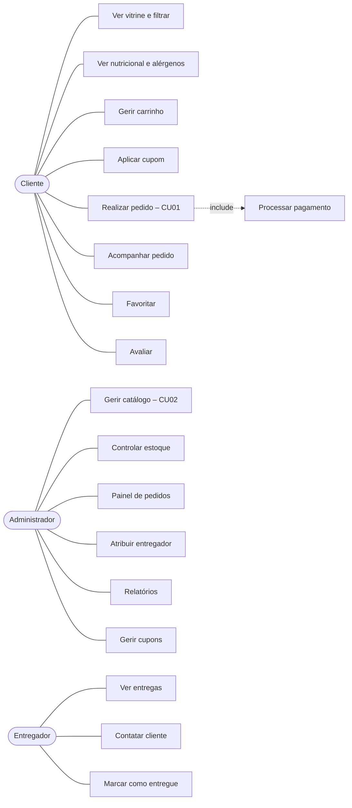
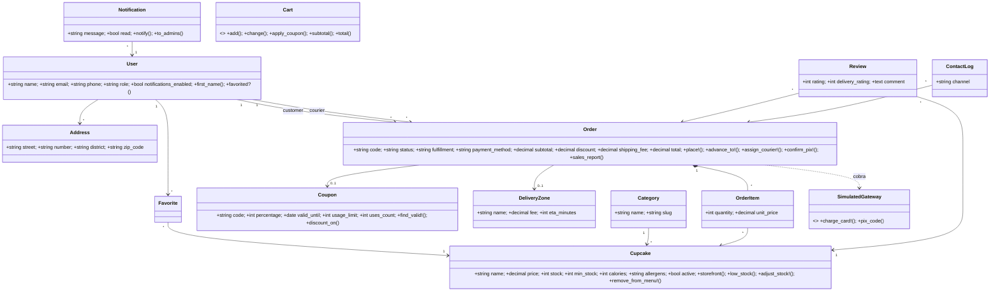
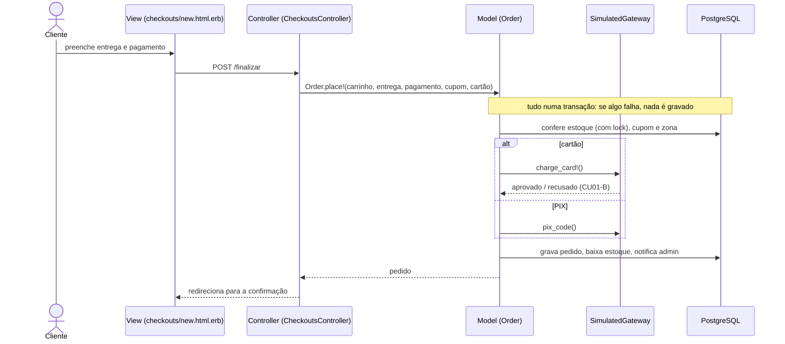
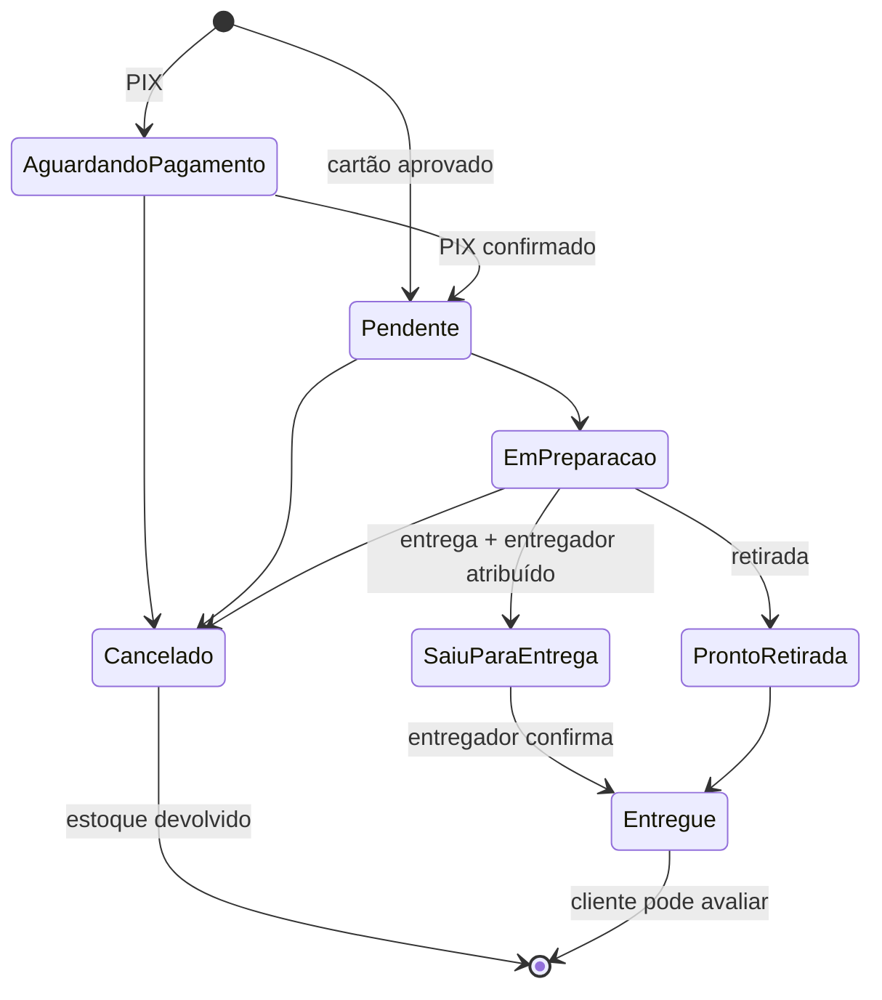
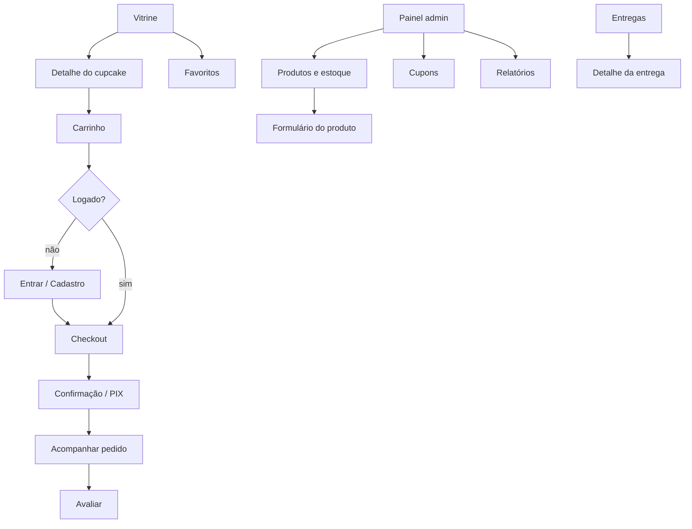

# Situação 1 – Plano de projeto atualizado

Revisão (kaizen) da documentação feita no PIT I para a loja **Sweet Indulgence Cupcakes**: escopo, modelagem UML, IHC e projeto de dados, agora preparados para a execução.

## 1. Escopo revisado

**Problema:** a loja de cupcakes gourmet precisa de uma loja virtual para vender, receber pedidos, organizar entregas e se relacionar com os clientes. Na versão anterior do software, o cliente não foi ouvido e o sistema não resolveu a dor da loja.

**Solução:** uma aplicação web *mobile-first* (abre no navegador do celular como um app), com três perfis:

| Perfil | O que faz |
|---|---|
| Cliente | Vê a vitrine, filtra, favorita, monta o carrinho, aplica cupom, escolhe entrega/retirada, paga (cartão ou PIX), acompanha o pedido e avalia |
| Administrador | Gerencia catálogo e estoque, cupons, painel de pedidos, atribui entregadores, vê relatórios e avaliações |
| Entregador | Vê as entregas atribuídas, abre o endereço no GPS, liga/manda WhatsApp e marca como entregue |

### O que mudou em relação ao PIT I

| Item do PIT I | Decisão no PIT II | Motivo |
|---|---|---|
| Linguagem do back-end | **Ruby on Rails 8.1** (Ruby 3.4) | A disciplina sugere Java, PHP, C#, .NET ou Python, "o que você estiver melhor familiarizado". Rails é o framework com que tenho mais familiaridade e segue o padrão MVC de forma nativa (models, views, controllers). Um primeiro protótipo foi feito em Flask (tag `v1-flask`) e substituído. |
| "Aplicação mobile" | Aplicação **web responsiva** (mobile-first) | Um único código atende celular e computador, sem publicar em loja de apps. Mantém o layout do wireframe (barra inferior, cabeçalho fixo). |
| Classes `Cliente`, `Administrador`, `Entregador` separadas | Uma tabela `users` com o campo `role` | Os três tinham os mesmos atributos (nome, e-mail); separar criaria três logins e duplicação. |
| Classe `Promocao` (nome, desconto) | `Coupon` com código, percentual, validade e limite de usos | O US06 exige validade e limite de usos (RN#1), que não estavam no diagrama. |
| `Pedido` só com data, status e total | Subtotal, desconto, frete, total, método de entrega e de pagamento | Necessário para os critérios de aceitação de US06, US07 e US08. |
| — | Novas classes `Category`, `DeliveryZone`, `Favorite`, `Review`, `Notification`, `ContactLog` | Exigidas por US02, US07, US05, US10, US09 e US18, e não estavam no diagrama. |
| Notificação **push** (US09) | Notificações **dentro do app** (🔔), respeitando a preferência do cliente | Push nativo depende de app instalado; fica para a versão mobile nativa. |
| Pagamento com gateway certificado (US08) | **Gateway simulado** com as mesmas regras (cartão aprovado/recusado, PIX) | Gateway real exige conta comercial e chaves de produção. A troca afeta só `app/models/simulated_gateway.rb`. |
| Mapa com o entregador em tempo real | Link "Abrir no GPS" (Google Maps) para o entregador | Rastreamento em tempo real exige app nativo com localização em segundo plano. |
| Nomes das classes e tabelas | Em inglês no código (`Order`, `Cupcake`...), telas em português | Convenção do Rails (plural automático das tabelas). A correspondência está na tabela da seção 2.2. |
| Regra "remover produto" | Produto sai do cardápio (desativado), não é apagado | Preserva o histórico de pedidos e relatórios. |
| Estoque | Baixa ao registrar o pedido e devolução ao cancelar | Evita vender o mesmo cupcake duas vezes enquanto o PIX não é pago. |

### Fora do escopo desta entrega
Chat em tempo real entre entregador e cliente (US18 CA#2 — substituído por WhatsApp), assinatura do cliente na entrega (US17 CA#2, opcional), exportação do relatório em PDF (o CSV está implementado), upload de fotos pelo administrador (os 10 sabores usam fotos reais do Wikimedia Commons, com [créditos](../creditos-das-fotos.md); cupcake novo usa uma ilustração gerada pelo sistema).

## 2. Modelagem UML revisada

### 2.1 Diagrama de casos de uso

### 2.2 Diagrama de classes (persistência)

Correspondência com o PIT I e com as telas:

| Classe (Rails) | Tabela | No PIT I / nas telas |
|---|---|---|
| `User` | `users` | Cliente, Administrador, Entregador |
| `Address` | `addresses` | Endereço do cliente |
| `Category` | `categories` | Categoria da vitrine |
| `Cupcake` | `cupcakes` | Produto |
| `Favorite` | `favorites` | Favorito |
| `Coupon` | `coupons` | Promoção / cupom |
| `DeliveryZone` | `delivery_zones` | Zona de entrega |
| `Order` / `OrderItem` | `orders` / `order_items` | Pedido / item do pedido |
| `Review` | `reviews` | Avaliação |
| `Notification` | `notifications` | Notificação |
| `ContactLog` | `contact_logs` | Registro de contato do entregador |
| `Cart` | (sessão do navegador) | Carrinho |

### 2.3 Diagrama de sequência – Realizar pedido (CU01)

### 2.4 Diagrama de atividades – ciclo de vida do pedido

## 3. IHC – telas, mensagens e protótipo

As telas seguem o wireframe do PIT I: cabeçalho fixo com logotipo e sacola, busca, filtros de categoria em círculo, grade de produtos com coração, e barra de navegação inferior (Início, Favoritos, Carrinho, Pedidos, Perfil) no celular. No computador, a barra inferior vira links no cabeçalho.

Mapa de telas:

Mensagens de erro (todas em português, perto da ação que as causou):

| Situação | Mensagem |
|---|---|
| Quantidade maior que o estoque | "Só temos 4 unidade(s) de Caramelo Salgado em estoque." |
| Cupom inexistente / vencido / esgotado | "Cupom inválido." / "Este cupom expirou." / "Este cupom atingiu o limite de usos." |
| Cartão recusado (CU01-B) | "Pagamento recusado pela operadora. Tente outro cartão ou pague com PIX." |
| Entrega sem bairro ou endereço | "Escolha o bairro/zona de entrega." / "Informe o endereço de entrega." |
| Produto com dados inválidos (CU02-A) | Lista de campos a corrigir, sem perder o que foi digitado |
| Remoção sem confirmação (CU02-B) | "Remoção cancelada: digite o nome exato do cupcake para confirmar." |
| Entregador sem confirmar com o cliente | "Confirme com o cliente antes de marcar como entregue." |
| Área restrita | Página "Acesso negado" (403) |

Os prints das telas implementadas estão em [`../situacao-3-testes/evidencias/telas/`](../situacao-3-testes/evidencias/telas/).

## 4. Projeto de dados

- **Conceitual:** entidades e relacionamentos do diagrama de classes (seção 2.2).
- **Lógico (normalizado até a 3FN):**
  - Endereços ficam em tabela própria (um cliente tem vários).
  - Itens do pedido ficam separados do pedido (1:N).
  - O preço unitário fica em `itens_pedido`, porque o preço do cupcake pode mudar depois da compra. Por isso não é redundância.
  - `favoritos` usa chave composta (usuário, cupcake) para impedir duplicidade.
  - Categorias e zonas de entrega são tabelas de domínio.
- **Físico:** PostgreSQL (SGBD popular e gratuito), o mesmo em desenvolvimento, testes e produção. As tabelas são criadas pelas migrations do Rails (`db/migrate/`), e o script completo gerado do banco está em [`schema-postgresql.sql`](schema-postgresql.sql). Restrições de integridade no banco: chaves estrangeiras, `UNIQUE`, `CHECK (preco > 0)`, `CHECK (estoque >= 0)`, `CHECK (rating BETWEEN 1 AND 5)`, `CHECK (percentage BETWEEN 1 AND 90)` e `CHECK (role IN ('customer', 'admin', 'courier'))`.
- **Dicionário de dados:** [`dicionario-de-dados.md`](dicionario-de-dados.md).
